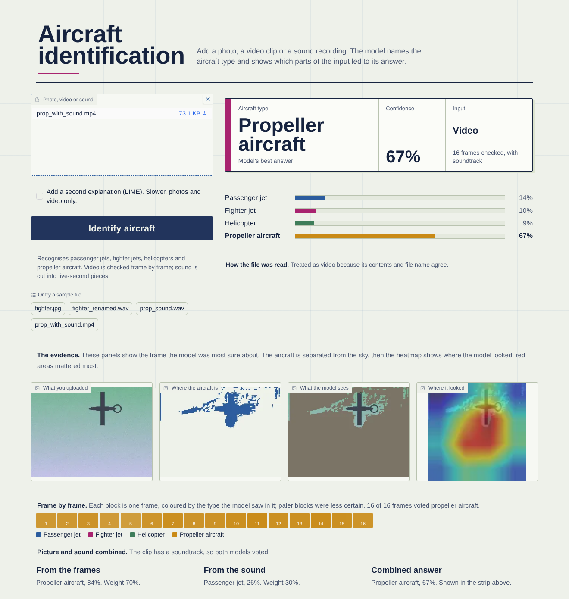
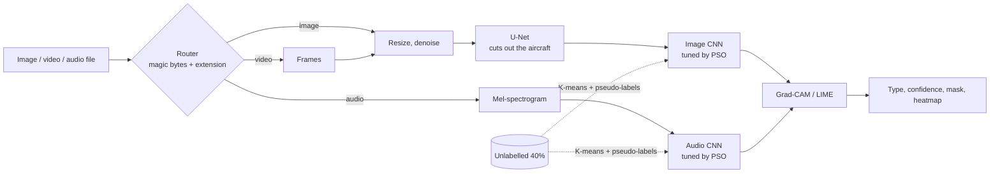

# Explainable Multimodal Aircraft Recognition using Deep Learning

A program that recognises the type of aircraft in a **photo, video or sound recording** and shows **why** it made that decision.

| | |
|---|---|
| **Classes** | Passenger jet · Fighter jet · Helicopter · Propeller aircraft |
| **Inputs** | Image, video, audio. The agent detects which one it received. |
| **Outputs** | Aircraft type, confidence, segmentation mask, Grad-CAM heatmap (and LIME) |
| **Techniques** | U-Net segmentation · ResNet-18 transfer learning · PSO / Genetic Algorithm / Grey Wolf optimisation · K-means + DBSCAN + pseudo-labelling · Grad-CAM + LIME · HOG/MFCC + SVM baseline |
| **Platform** | Python + PyTorch on Google Colab (free T4 GPU) |

## The demo



The interface borrows from aeronautical charts: chart paper, navy ink, airspace magenta. Each answer is shown as an air-traffic-control flight strip. Unconfirmed answers get an amber hatched band. *(Screenshot from the smoke-test models, so the numbers are not real results.)*

## Pipeline



Videos are classified frame by frame and decided by **majority vote**. When a video has a soundtrack, the image and audio probabilities are **fused**. Low-confidence answers come back as *"Not sure: possibly not an aircraft"*.

## Quick start (Google Colab)

1. Open `notebooks/Aircraft_Recognition_Colab.ipynb` in Colab (File → Open notebook → GitHub tab, paste this repo's URL).
2. Runtime → Change runtime type → **T4 GPU**.
3. Run the cells top to bottom. Every step saves to `MyDrive/aircraft_project/`, so after a disconnect you re-run the two setup cells and continue from the step you were on.

You need a Google account (about 15 GB free in Drive), a Kaggle account (for the military dataset) and 15–20 short aircraft video clips of your own, placed in `MyDrive/aircraft_project/videos/<class>/`.

Approximate times on a T4: data preparation 30–45 min, U-Net 15 min, baselines 20 min, optimizer comparison 1–2 h (set `cfg.hpo_budget = 12` to shorten it), pseudo-labelling 15 min, extras 30–45 min.

### Command line

```bash
pip install -r requirements.txt
python scripts/run_all.py --root ./workdir --download          # whole project
python -m aircraft_recog.app --root ./workdir --share           # demo only, after training
```

### 5-minute smoke test (no downloads, CPU is fine)

```bash
python scripts/make_synthetic_data.py --root ./smoke
python scripts/run_all.py --root ./smoke --fast
```

This builds tiny cartoon datasets in the same folder layouts as the real downloads and runs every step, including the demo models. Use it to check your setup before spending GPU time. Its accuracy numbers mean nothing.

## Repository layout

```
aircraft_recog/
  config.py          paths, classes, all training settings
  class_map.py       dataset class names -> our 4 classes (edit here to add aircraft)
  data_prep.py       Steps 1-3: download, scan, convert, clean, 5,000-sample mix, group-aware splits, 40% unlabelled
  convert.py         video -> frames, audio -> mel-spectrogram, ffmpeg soundtrack extraction
  router.py          Step 4: file-type detection by content and extension
  masks.py           Step 5a: GrabCut masks from bounding boxes
  segmentation.py    Step 5b: U-Net training, IoU / Dice, mask prediction
  datasets.py        augmentation (data synthesis), SpecAugment, mask application
  classifier.py      Step 6: ResNet-18 / EfficientNet-B0 transfer learning, metrics, video voting
  optimizers.py      Step 7: PSO, Genetic Algorithm, Grey Wolf, random search (written from scratch)
  hpo.py             fair optimizer comparison (same budget), convergence plot
  semi_supervised.py Step 8: features, K-means vs DBSCAN, silhouette, pseudo-labels, t-SNE
  explain.py         Step 9: Grad-CAM (written out step by step) and LIME
  baseline_svm.py    HOG + SVM and MFCC + SVM
  synthesis.py       small-to-large data synthesis experiment
  experiments.py     results table, ablation table, confusion matrices
  steps.py           the build plan as functions (used by the notebook and run_all.py)
  pipeline.py        the agent: route -> convert -> segment -> classify -> explain (+ voting, fusion, reject)
  app.py             Step 10: Gradio demo
notebooks/Aircraft_Recognition_Colab.ipynb
scripts/run_all.py, scripts/make_synthetic_data.py
```

## What gets produced (in `results/`)

| File | Report use |
|---|---|
| `results_table.csv` | Main results table: baseline → +segmentation → +PSO → +pseudo-labels, for image / video / audio |
| `optimizer_comparison.csv`, `optimizer_convergence.png` | Manual vs random vs PSO vs GA vs GWO, same 30 runs each |
| `ablation_table.csv` | Contribution of segmentation, PSO and pseudo-labels |
| `svm_vs_cnn.csv` | Classical ML vs deep learning |
| `synthesis_experiment.png` | Accuracy as 30 images per class grow to 750 |
| `unet_metrics.json`, `unet_samples.png` | Segmentation IoU / Dice and examples |
| `confusion_image.png`, `confusion_audio.png`, `final_test_metrics.json` | Accuracy, precision, recall, macro F1 |
| `tsne_image.png`, `tsne_audio.png`, `semi_supervised.json` | Clusters, silhouette scores, pseudo-label accuracy |
| `gradcam_image.png`, `gradcam_audio.png`, `gradcam_vs_lime.png` | Explanations for correct and wrong predictions |

## Requirement checklist

| Requirement | Where |
|---|---|
| CV, ML and DL concepts | CV: preprocessing, GrabCut, frames. ML: SVM, K-means, DBSCAN, PSO/GA/GWO. DL: U-Net, CNNs |
| Image, video or audio input; agent distinguishes them | `router.py`, `pipeline.py` |
| ~5,000 samples, labelled + unlabelled | `data_prep.py` (3,500 + 1,000 + 500; 40% of train hidden) |
| Clean, structured input | resize, denoise, normalise, fixed folder layout, `manifest.csv` |
| Synthesize small → large | `datasets.py` augmentation, `synthesis.py` experiment |
| Processing and segmentation | `masks.py`, `segmentation.py` |
| Deep learning architecture | U-Net + ResNet-18 transfer learning |
| Nature-inspired algorithms | `optimizers.py`: swarm (PSO), genetic (GA), animal (Grey Wolf) |
| Optimisation with before / after | `hpo.py`, results table |
| Classify and cluster | 4-class CNNs + K-means / DBSCAN |
| Explainable AI | Grad-CAM + LIME |
| Real application | Aerospace. The same pipeline can be retrained on medical or biological images |

## Datasets

* **FGVC-Aircraft** (Maji et al., 2013): research use only. https://www.robots.ox.ac.uk/~vgg/data/fgvc-aircraft/
* **Military Aircraft Detection Dataset** (Kaggle): https://www.kaggle.com/datasets/a2015003713/militaryaircraftdetectiondataset
* **AeroSonicDB YPAD-0523** (Downward & Nordby, 2023): CC BY-NC 4.0. https://zenodo.org/records/8371595
* Self-collected video clips

Datasets are downloaded at run time and are **not** stored in this repository.

## Limitations

* AeroSonicDB was recorded near a civil airport, so audio covers three classes (no fighters).
* Segmentation masks come from bounding boxes via GrabCut, so they are approximate. U-Net IoU is measured against these masks.
* The video set is small and self-collected, so video results are a demonstration rather than a benchmark.
* PSO uses a small swarm (6 particles × 5 rounds) on a data subset, because every evaluation is a training run.
* Trained on public photos, the model may be less accurate on distant or blurry aircraft.

## Key references

Ronneberger et al. 2015 (U-Net) · He et al. 2016 (ResNet) · Kennedy & Eberhart 1995 (PSO) · Holland 1975 (GA) · Mirjalili et al. 2014 (Grey Wolf) · Lee 2013 (Pseudo-Label) · Selvaraju et al. 2017 (Grad-CAM) · Ribeiro et al. 2016 (LIME) · Hershey et al. 2017 (audio CNNs) · Park et al. 2019 (SpecAugment) · Rother et al. 2004 (GrabCut) · Dalal & Triggs 2005 (HOG). The full list is in the project guide.
